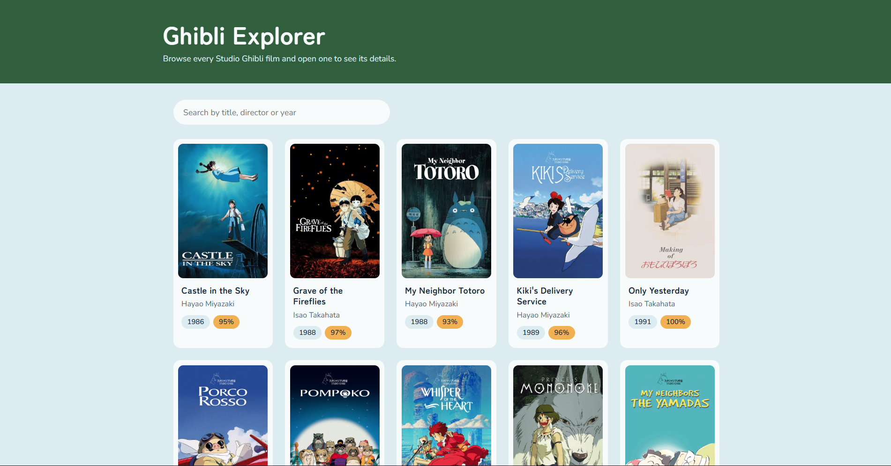
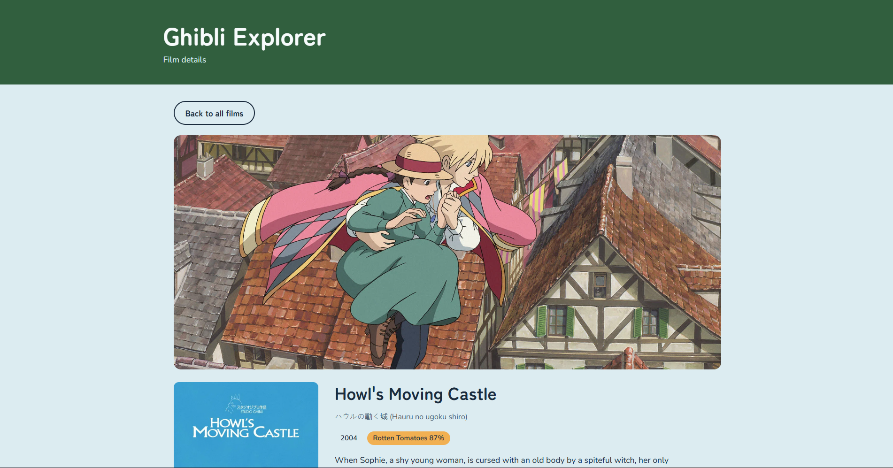

# Ghibli Explorer

React application that consumes the public **Studio Ghibli API** and shows its films in two views: a general view (grid of films with search) and a detail view (full information of one film).

Project for the **DWEC – Client-Side Web Development** module.

## Group members

- _Samuel Gallego Pintado_
- _Victor Kirilov Velev_
- _Fernando Guadalupe Ramos_

## Chosen API

**Studio Ghibli API** (unofficial, community-maintained, no API key needed).

- Base URL: `https://ghibliapi.vercel.app`
- Documentation / source: https://github.com/janaipakos/ghibliapi
- Endpoints used: `GET /films` and `GET /films/{id}`

## File structure

```
ghibli-explorer/
├── public/                  # Static files
├── src/
│   ├── services/
│   │   └── api.js           # ALL the fetch calls of the project
│   ├── components/
│   │   ├── atoms/           # Smallest elements (Button, Image, Title...)
│   │   ├── molecules/       # Groups of atoms (FilmCard, SearchBar...)
│   │   ├── organisms/       # Complex sections (Header, FilmList, FilmDetail)
│   │   ├── templates/       # Page layouts without real data (MainTemplate)
│   │   └── pages/           # Templates filled with real data (HomePage, DetailPage)
│   ├── App.jsx              # useState navigation between pages
│   ├── main.jsx             # React entry point
│   └── index.css            # Global styles and CSS variables
├── index.html
├── package.json
└── README.md
```

Every component has its own `.jsx` and `.css` file in the same folder.

## Example of API access

Request:

```
GET https://ghibliapi.vercel.app/films
```

Extract of the JSON response (shortened; check the real response in your browser):

```json
[
  {
    "id": "2baf70d1-42bb-4437-b551-e5fed5a87abe",
    "title": "Castle in the Sky",
    "original_title": "天空の城ラピュタ",
    "original_title_romanised": "Tenkū no shiro Rapyuta",
    "image": "https://image.tmdb.org/...",
    "movie_banner": "https://image.tmdb.org/...",
    "description": "The orphan Sheeta inherits a mysterious crystal...",
    "director": "Hayao Miyazaki",
    "producer": "Isao Takahata",
    "release_date": "1986",
    "running_time": "124",
    "rt_score": "95"
  }
]
```

Service functions (`src/services/api.js`):

```js
const BASE_URL = "https://ghibliapi.vercel.app";

async function request(path) {
  let response;
  try {
    response = await fetch(`${BASE_URL}${path}`);
  } catch {
    throw new Error("Could not reach the Studio Ghibli API. Check your connection.");
  }
  if (!response.ok) {
    throw new Error(`The API answered with an error (${response.status}).`);
  }
  return response.json();
}

export async function getFilms() {
  const films = await request("/films");
  return films.sort((a, b) => Number(a.release_date) - Number(b.release_date));
}

export async function getFilmById(id) {
  return request(`/films/${id}`);
}
```

## Components

**Atoms**
- `Title`: heading (h1–h3) with BEM modifiers for level and light colour.
- `Text`: paragraph, with muted, light and clamped variants.
- `Button`: button with `primary` and `ghost` variants.
- `Image`: image with a placeholder when there is no source or it fails to load.
- `Badge`: small label (year, score).
- `Spinner`: loading indicator.

**Molecules**
- `FilmCard`: clickable card with poster, title, director, year and score.
- `SearchBar`: labelled search input.
- `InfoRow`: label + value row used in the detail view.
- `StatusMessage`: error message with a "Try again" button.

**Organisms**
- `Header`: site title and subtitle.
- `FilmList`: grid of `FilmCard` (or an empty-search message).
- `FilmDetail`: complete information of one film and the back button.

**Templates**
- `MainTemplate`: layout with header slot, main content and footer.

**Pages**
- `HomePage`: loads all films, handles loading/error and the search filter.
- `DetailPage`: loads one film by id, handles loading/error.

## Navigation

There is no React Router. `App.jsx` keeps a state `selectedFilmId` created with `useState(null)`:

- `null` → `HomePage` (general view) is rendered.
- A film id → `DetailPage` (detail view) is rendered for that film.

`HomePage` receives `onSelectFilm` (the state setter) and calls it when a card is clicked. `DetailPage` receives `onBack`, which sets the state back to `null`.

## Hooks

Only `useState` and `useEffect` are used (no custom hooks).

- `App`: `useState` for `selectedFilmId` (navigation).
- `HomePage`: `useState` for `films`, `loading`, `error`, `query` (search text) and `attempt` (to retry the request). `useEffect` with `[attempt]` calls `getFilms()` when the page appears and when the user presses "Try again".
- `DetailPage`: `useState` for `film`, `loading`, `error`, `attempt`. `useEffect` with `[filmId, attempt]` calls `getFilmById()`; another `useEffect` with `[]` scrolls to the top.
- `Image`: `useState` to remember if the image failed to load.
- The effects use an `ignore` flag in the cleanup function so an old response never overwrites the state.

## How to run the project

```bash
npm install
npm run dev
```

Then open the local URL shown in the terminal (usually http://localhost:5173).

## Screenshots

_Add here a screenshot of the general view and one of the detail view._

- `General view`
  
- `Detail view `
- 
